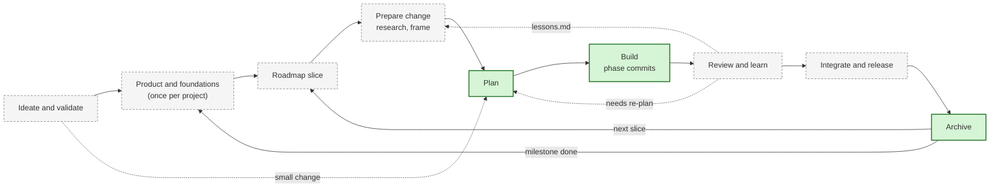
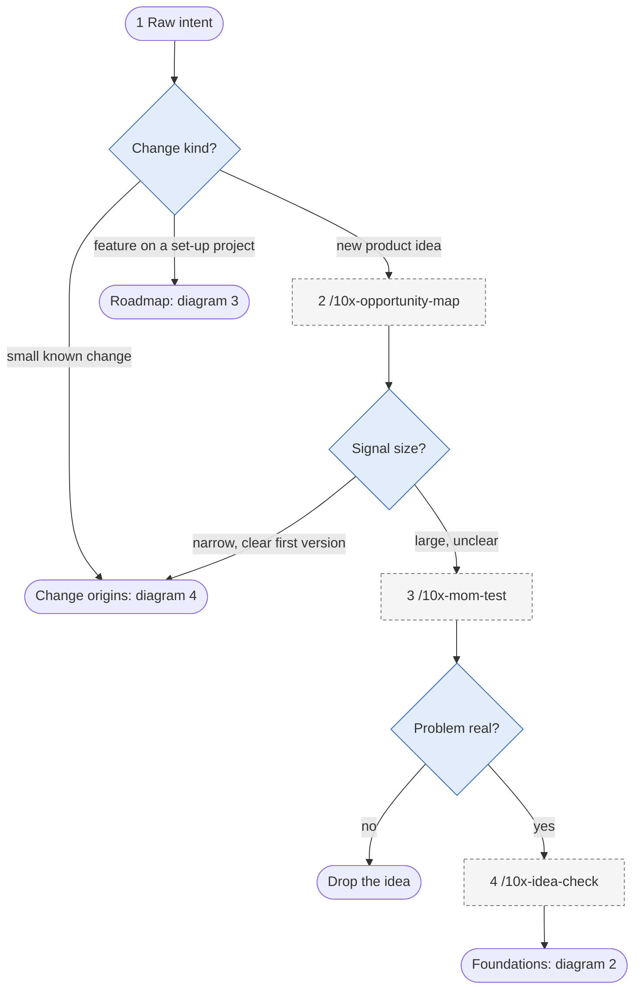
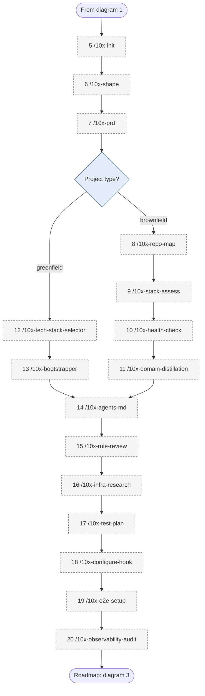
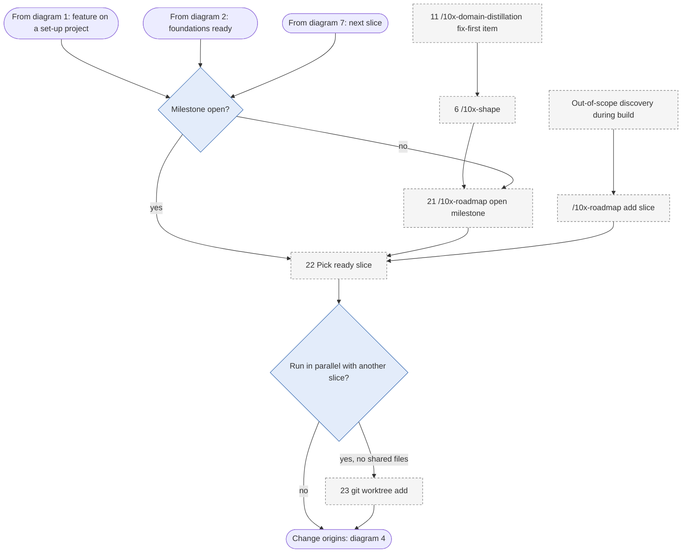
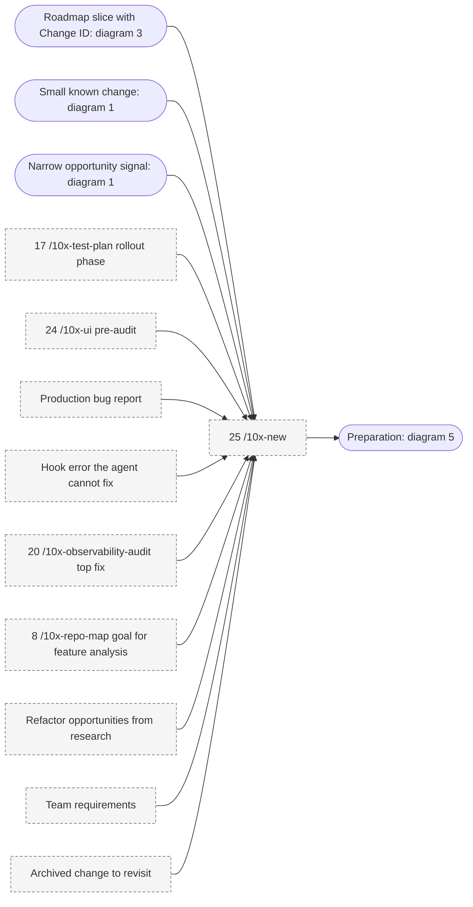
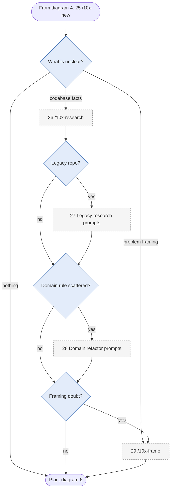
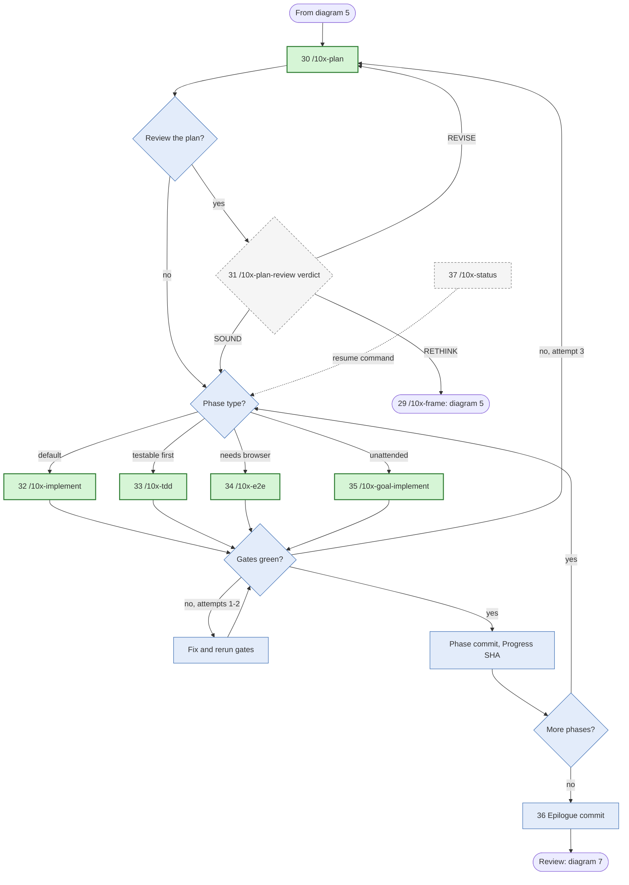
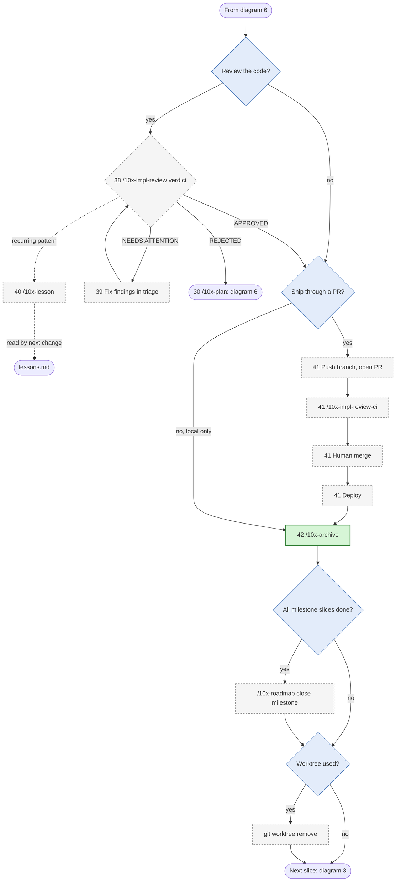
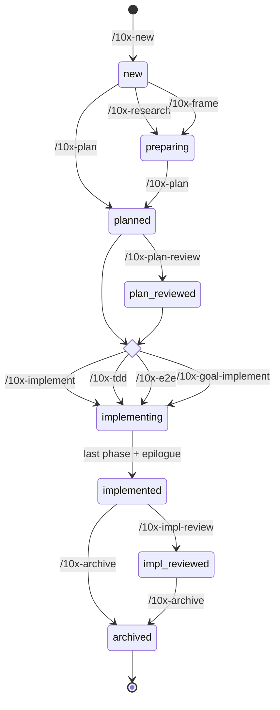

# ADR-002: Change lifecycle from ideation to archive, with a three-step mandatory core and every other step optional

- **Status:** Proposed
- **Date:** 2026-10-30
- **Deciders:** repository owner
- **Sources:** the 10xDevs 4.0 toolkit and lessons in `../10xdevs4-content/` (CLI manifest 1.30.0, lesson `m5l5`): skills in `.claude/skills/*/SKILL.md`, prompts in `.claude/prompts/`, lessons in `en/m1` to `en/m5`.

## Context

agent-smith runs a fixed slice of the 10x chain today: plan, plan review, implement, implementation review, fix (see `skills/10x-pipeline/SKILL.md`). The toolkit has 39 skills and many more steps around that slice: idea validation, product shaping, project foundations, roadmap slices, research, framing, test-first and E2E execution, CI review, lessons and archiving.

The skills already hand work to each other through files, not through memory:

- **Project level:** `context/foundation/*.md` (shape notes, PRD, tech stack, roadmap, test plan, lessons, infrastructure), `context/map/repo-map.md`, `context/domain/*.md`, `context/audits/`.
- **Change level:** `context/changes/<change-id>/` with `change.md` (identity and `status`), `research.md`, `frame.md`, `plan.md` with a `## Progress` section, `plan-brief.md`, and `reviews/plan-review.md` and `reviews/impl-review.md`.
- **Closed:** `context/archive/<created>-<change-id>/`, read-only by convention.

Three statuses move in parallel:

- `change.md` `status`: `new` → `preparing` → `planned` → `plan_reviewed` → `implementing` → `implemented` → `impl_reviewed` → `archived`.
- Roadmap item `Status` (matched by `Change ID`): `proposed | ready | blocked` → `planning` → `in-progress` → `done`.
- Plan `## Progress` rows: `[ ]` → `[x]` plus the commit SHA, one phase per Conventional Commit.

No single document shows the whole path of one change, which steps are optional, and when to use each one. Without that map, agent-smith cannot decide which steps to add to its router next or which ones it may safely skip.

## Decision

Adopt one canonical change lifecycle with 9 stages and 42 steps.

1. **Mandatory core: three steps.** `/10x-plan` → one executor (`/10x-implement`, `/10x-tdd`, `/10x-e2e` or `/10x-goal-implement`) → `/10x-archive`. Every other step is optional. `/10x-new` is optional because `/10x-plan`, `/10x-research` and `/10x-frame` create the change folder and `change.md` when missing. `/10x-archive` is lenient: it warns about missing reviews and open Progress rows but only blocks on uncommitted files.
2. **Each optional step has an entry trigger.** Run it only when the trigger holds. The step catalog below lists the triggers.
3. **Project-level steps run once and are re-entered on demand.** Stages A to C feed every later change through `context/foundation/`. A change may skip them when the artifacts already exist or are not needed.
4. **Files carry state, skills do not.** A step reads the artifacts of earlier steps and writes its own. `plan.md` `## Progress` is the single source of truth for build progress.
5. **Loops go backward, never around.** A failed review goes back to plan or frame. A misjudged scope goes back to frame. A discovery during build adds a new roadmap slice and a new change, not extra work in the current one.
6. **Out of scope:** `/10x-ray` (learning aid for skills), `pack-init`, `setup-cicd` and `tf-registry` (team toolkit distribution, module 5 lesson 4). They support the workflow but are not steps of a change.

Legend for the "Need" column: **Core** = mandatory; **Opt** = optional; **Once** = optional, once per project, re-run on demand; **Auto** = done by another skill, no separate command.

## Step catalog

### Stage A: Ideation and validation

| # | Step | Need | Writes | What |
|---|------|------|--------|------|
| 1 | Raw intent | Core | nothing | Idea, bug, ticket or friction shows up. Write one line. Everything starts here. |
| 2 | `/10x-opportunity-map` | Opt | opportunity map | Pain real, but build? Map build, buy, complement or wait. Pick one candidate. |
| 3 | `/10x-mom-test` | Opt | critique, interview guide, go/no-go criteria | Check problem real. Ask about past behavior, not opinions. No pain, no build. |
| 4 | `/10x-idea-check` | Opt | verdict in chat | Idea fit time and skill? Too big, cut. Too small, grow. |

### Stage B: Product and project foundations (once per project)

| # | Step | Need | Writes | What |
|---|------|------|--------|------|
| 5 | `/10x-init` | Once | `context/{changes,archive,foundation}/` + READMEs | No `context/`? Make skeleton. Other skills need it. |
| 6 | `/10x-shape` | Once | `context/foundation/shape-notes.md` | Talk idea through. Socratic questions. Greenfield or brownfield, auto-detected. |
| 7 | `/10x-prd` | Once | `context/foundation/prd.md` | Turn notes into PRD. Locked schema. FRs and user stories for roadmap. |
| 8 | `/10x-repo-map` | Once | `context/map/repo-map.md` | Old repo, new to you? Map capabilities. Rank hot zones by criticality and buzz. |
| 9 | `/10x-stack-assess` | Once | `context/foundation/stack-assessment.md` | Brownfield. Score stack for agents: typed, conventions, popular, documented. |
| 10 | `/10x-health-check` | Once | `context/foundation/health-check.md` | Brownfield. Audit deps, security, tests, CI. Verdict: agent-ready or not. |
| 11 | `/10x-domain-distillation` | Once | `context/domain/domain-distillation.md`, `glossary.md` | Legacy domain unnamed? Distil language, invariants, drift. Glossary rules names after. |
| 12 | `/10x-tech-stack-selector` | Once | `context/foundation/tech-stack.md` | Greenfield. Pick starter and stack from PRD. Agent-friendly gates. |
| 13 | `/10x-bootstrapper` | Once | scaffolded app, verification log | Greenfield. Run starter CLI. Keep `context/` safe. |
| 14 | `/10x-agents-md` | Once | `AGENTS.md` | Write agent onboarding. Critical rules on top. Short, reference-heavy. |
| 15 | `/10x-rule-review` | Opt | scorecard, fixes | Rules file rot? Score 5 points. Fix. |
| 16 | `/10x-infra-research` | Once | `context/foundation/infrastructure.md` | Where deploy? Short interview, bias-checked web research. Scored platforms, risks. |
| 17 | `/10x-test-plan` | Once | `context/foundation/test-plan.md` | Brownfield. Rank risks, set quality gates. Runs its own phases as changes. |
| 18 | `/10x-configure-hook` | Once | harness hook config + scripts | Turn gates into hooks. Prove each hook on broken file. Agent sees errors itself. |
| 19 | `/10x-e2e-setup` | Once | `playwright.config.ts`, seed test, `context/foundation/test-stack.md` | Web app, no Playwright? Install, config, one green seed test. |
| 20 | `/10x-observability-audit` | Opt | `context/audits/observability/<date>.md` | Errors vanish in prod? Hunt swallowed exceptions, lost traces, silent logs. |

### Stage C: Roadmap and lane selection

| # | Step | Need | Writes | What |
|---|------|------|--------|------|
| 21 | `/10x-roadmap` (open milestone) | Opt | `context/foundation/roadmap.md` | Open outcome milestone. Cut PRD into vertical slices. Each slice gets `Change ID`. |
| 22 | Pick next slice | Opt | nothing | Read roadmap. Take `ready` slice, north star first. `blocked` slice waits for unknowns. |
| 23 | Parallel check + `git worktree` | Opt | worktree, branch | Two slices, no shared files? One worktree per agent. Shared files, go one by one. |

### Stage D: Change preparation

| # | Step | Need | Writes | What |
|---|------|------|--------|------|
| 24 | `/10x-ui` pre-audit | Opt | audit brief | UI change on view that renders? Audit 3–5 charges. Suggest change-id. Feed research. |
| 25 | `/10x-new` | Opt | `change.md` (`status: new`) | Make change folder. Seed notes from intent. Many origins feed it: see diagram 4. Plan, research and frame also make it if missing. |
| 26 | `/10x-research` | Opt | `research.md` (`status: preparing`) | Plan needs ground truth? Parallel subagents read code, cite sources. Facts only. |
| 27 | Legacy research prompts | Opt | `research.md` additions | Big legacy repo? Research with map, verify claims with ast-grep, rank refactor spots. |
| 28 | Domain refactor prompts | Opt | refactor brief | Rule enforced many places or none? Plan guardian aggregate. External API leaks? Plan anti-corruption layer. |
| 29 | `/10x-frame` | Opt | `frame.md` (`status: preparing`) | Symptom and fix glued together? Split. Ask what to build, not how. |

### Stage E: Planning

| # | Step | Need | Writes | What |
|---|------|------|--------|------|
| 30 | `/10x-plan` | Core | `plan.md`, `plan-brief.md` (`status: planned`); roadmap item → `planning` | Write phased plan. Success criteria per phase, automated and manual. Approve phases. |
| 31 | `/10x-plan-review` | Opt | `reviews/plan-review.md` (`status: plan_reviewed`) | Check plan before code. Verdict SOUND, REVISE or RETHINK. REVISE fix plan; RETHINK go back to frame. |

### Stage F: Build (pick one executor per phase; phases may mix)

| # | Step | Need | Writes | What |
|---|------|------|--------|------|
| 32 | `/10x-implement` | Core (default) | code, one commit per phase, Progress `[x]` + SHA (`status: implementing`); roadmap item → `in-progress` | Build phase. Gates cheap first: plan criteria, deliberate break, full suite. Commit only on green. |
| 33 | `/10x-tdd` | Core (alt) | same as above | Phase testable first? Red, green, refactor. Non-TDD phase hand off to implement. |
| 34 | `/10x-e2e` | Core (alt) | Playwright specs, `test(<id>)` commits | Risk needs browser and feature built? Plan, generate, review, verify one risk. |
| 35 | `/10x-goal-implement` | Core (alt) | same as implement, no questions | Nobody watching? Subagent per phase, auto gates, commits. Manual rows become human checklist. Remote or async agent runs this. |
| 36 | Epilogue commit | Auto | `chore(<id>): close out plan (epilogue)` (`status: implemented`) | Last SHA write-back plus status flip. Executor does it. |
| 37 | `/10x-status` | Opt | nothing | Lost? Show status, Progress and drift for every change. Copy resume command. |

### Stage G: Review and learning

| # | Step | Need | Writes | What |
|---|------|------|--------|------|
| 38 | `/10x-impl-review` | Opt (strongly advised) | `reviews/impl-review.md` (`status: impl_reviewed`) | Code vs plan: drift, danger, patterns. Verdict APPROVED, NEEDS ATTENTION or REJECTED. Triage each finding. |
| 39 | Fix loop | Opt | fix commits | Finding real? Fix now in triage. Big fix? Back to plan. Gate fails twice? Stop, debug, re-plan. |
| 40 | `/10x-lesson` | Opt | `context/foundation/lessons.md` | Same bug twice? Write rule. Frame, research, plan, implement and reviews read it next time. |

### Stage H: Integration and release

| # | Step | Need | Writes | What |
|---|------|------|--------|------|
| 41 | Push, PR, `/10x-impl-review-ci`, merge, deploy | Opt | PR, CI review comment, `reviews/impl-review.md` on branch, release | Push branch. CI agent reviews PR against plan and Definition of Done. Human merges. Deploy per `infrastructure.md`. |

### Stage I: Close

| # | Step | Need | Writes | What |
|---|------|------|--------|------|
| 42 | `/10x-archive` | Core | `context/archive/<created>-<change-id>/` (`status: archived`); roadmap item → `done` | Move folder with `git mv`. Stamp `archived_at`. Warn on gaps, block only on uncommitted files. Then folder read-only. |
| — | `/10x-roadmap` (close milestone) | Opt | `roadmap.md` | All slices `done`? Close milestone. Open next one. Loop to stage C. |
| — | Remove worktree | Opt | nothing | Lane done and merged? `git worktree remove`. Branch delete. |

## Diagrams

### High-level workflow

Solid green boxes are the mandatory core. Dashed boxes are optional stages.

### Detailed change flow

Seven diagrams, one per group of stages. Rounded nodes link to the other diagrams. Green nodes are the mandatory core. Dashed nodes are optional. Blue nodes are decisions or automatic steps. Every branch is its own edge.

#### 1. Ideation (stage A)

#### 2. Product and project foundations (stage B, once per project)

#### 3. Roadmap and lanes (stage C)

#### 4. Change origins (inputs into `/10x-new`)

Sources: roadmap slice (`10x-roadmap`, lesson m2l2), opportunity signal (lesson m5l1), test-plan phase (`10x-test-plan`), UI audit (`10x-ui`), production bug (lesson m3l5), hook error (lesson m3l3), observability fix (`10x-observability-audit`), repo-map goal (lesson m4l3), refactor opportunities (prompt `m4l4-1-new-change-intention`), team requirements (prompt `m5l3-cicd`), archived change (`10x-archive`). `/10x-new` stays optional: `/10x-plan`, `/10x-research` and `/10x-frame` create the folder when it is missing.

#### 5. Change preparation (stage D)

#### 6. Planning and build (stages E and F)

Any one of steps 32 to 35 satisfies the build step. Phases of one plan may use different executors.

#### 7. Review, release and close (stages G, H and I)

### Change status lifecycle

A change created directly by `/10x-plan`, `/10x-research` or `/10x-frame` starts in `new` without a separate `/10x-new` call. The roadmap item moves alongside it: `/10x-plan` sets `planning`, the first executor sets `in-progress`, `/10x-archive` sets `done`. All three flips are forward-only.

## Consequences

- The minimum valid change is three commands: `/10x-plan`, one executor, `/10x-archive`. agent-smith may skip any other step without breaking the artifact contract, because each skill tolerates a missing optional input.
- agent-smith currently covers steps 30, 31, 35, 38 and 39. Candidate additions, in order of value: step 26 (`/10x-research`) and step 29 (`/10x-frame`) before the plan, step 42 (`/10x-archive`) after an approved review, and step 40 (`/10x-lesson`) when a review records a rule. Each needs its own routing rule in `policy.json` and must stay non-interactive, because subagents cannot use `AskUserQuestion`.
- Project-level steps (stages A to C) stay outside the pipeline. They need human answers (shaping, interviews, platform choice), and they run once per project, not once per change.
- `change.md` `status` is the cheapest signal for "where is this change". The router can read it next to `## Progress` and the review verdicts without an LLM, consistent with ADR-001.
- Step 41 needs a remote, a CI runner and secrets. agent-smith does not push or merge on its own; a human or `/10x-impl-review-ci` in CI owns that step.
- The catalog reflects toolkit version 1.30.0. A toolkit update can add, rename or reorder skills, so re-check this ADR when `.10x-cli-manifest.json` changes.

## Alternatives considered

- **Document only the mandatory core.** Short, but hides the triggers that tell an agent when research, framing or a review is worth the tokens.
- **Treat every skill as mandatory.** Matches the lessons' teaching order, but wastes effort on small changes and contradicts the lenient design of `/10x-archive` and the handoff defaults of `/10x-new` (default next step is `/10x-plan`).
- **One flat list without stages.** Hides that stages A to C run once per project while stages D to I run once per change.
